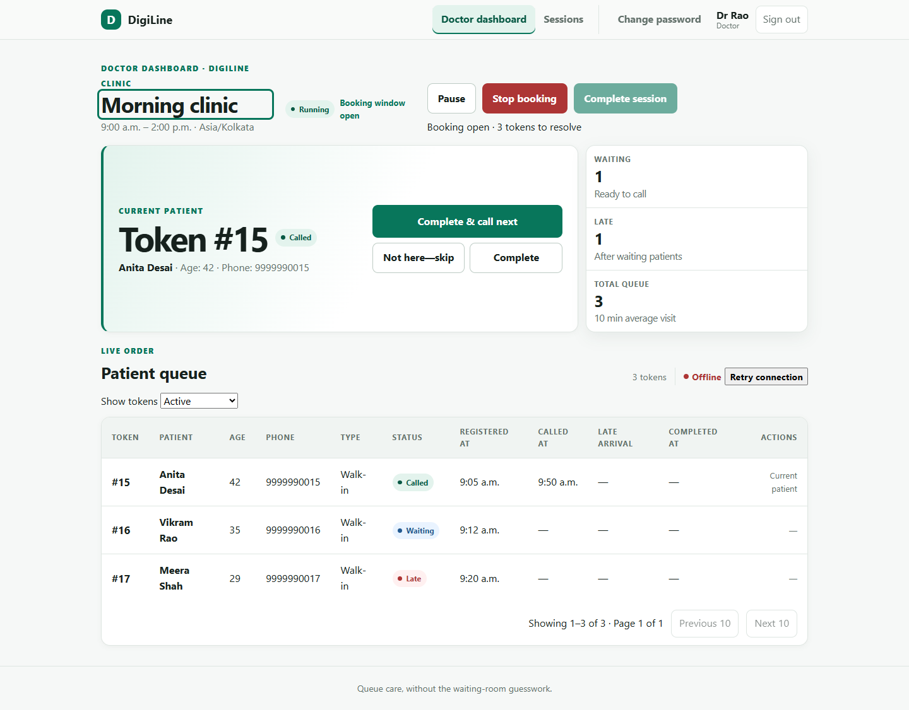
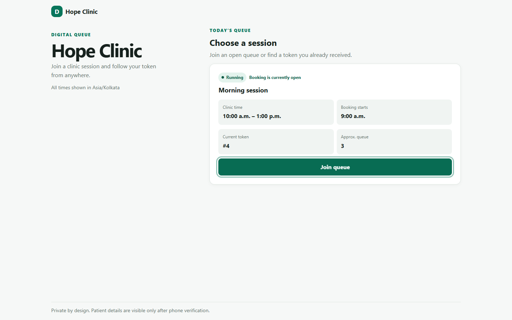
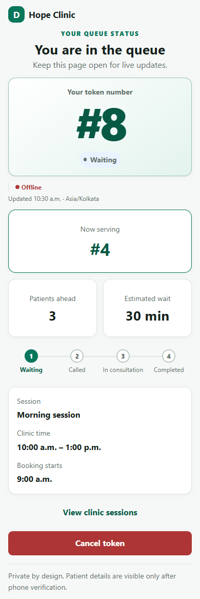

# DigiLine

A full-stack portfolio project for managing clinic queues. Patients can see their token and the current serving number, while doctors and reception staff control admissions and patient flow.

**Demo limitation:** patient phone verification is simulated. Development displays the code, and no real SMS delivery proves ownership of a phone number. Replace this mechanism before using real patient data.

[Portfolio presentation](docs/portfolio/DigiLine-Portfolio.pptx) · [Slide preview](docs/portfolio/DigiLine-Portfolio-Preview.pdf) · [Architecture](ARCHITECTURE.md) · [Local setup](docs/local-development.md) · [Operations](docs/operations.md)

## What it does

- **Patients:** join an open session, follow an issued token, recover an existing token after booking closes, and cancel while awaiting service.
- **Doctors:** manage sessions, call or skip patients, complete a token, or explicitly complete and call the next patient.
- **Reception:** register walk-ins, monitor queues, cancel tokens, and record late arrivals.
- **Administrators:** register clinics, create active staff accounts, assign multiple roles, and manage account access.

Stopping booking prevents new admissions while existing patients continue through the queue. Session completion is a separate, guarded doctor action.

## Product views



<details>
<summary>Patient views on desktop and mobile</summary>





</details>

Screenshots use synthetic Playwright fixtures captured on 16 September 2026. Offline indicators reflect mocked API/realtime connections. Some status wording predates the subsequent label standardization; these are illustrative captures, not proof of live connectivity.

## Stack and architecture

React 19, TypeScript, and Vite provide the web application. ASP.NET Core 9 exposes the API, EF Core persists data in SQL Server, and SignalR prompts live views to refresh. Staff authentication uses JWTs.

| Layer | Responsibility |
| --- | --- |
| Domain | Session and token lifecycle rules |
| Application | Booking, queue, and session use cases |
| Infrastructure | Persistence, transactions, authentication, mail, and patient access |
| API | HTTP endpoints, authorization, and realtime hubs |

See [architecture and dependency boundaries](ARCHITECTURE.md).

## Key decisions

- **Independent booking and lifecycle state:** a Running session can stop admissions without becoming Completed.
- **Explicit completion:** Call Next never silently completes the current patient. Completion checks unfinished tokens and confirms Skipped-to-NoShow finalization.
- **Transactional mutations:** session-first database locking coordinates competing queue actions; events follow commit.
- **Scoped access:** clinic/doctor ownership checks, multiple staff roles, password hashing, and credential revocation protect staff workflows.
- **Bounded reads:** server pagination and independent queue summaries avoid embedding every token in session lists. Clients discard stale responses and refresh after reconnecting.

## Run locally

Follow [local development](docs/local-development.md) for .NET 9, SQL Server, secrets, migrations, and frontend startup. Open `/register` to create a clinic without development seeds. Optional seeded accounts remain available for demonstrations.

```powershell
# After configuring the local database and signing secret
dotnet ef database update --project DigiLine.Infrastructure --startup-project DigiLine.API
dotnet run --project DigiLine.API --launch-profile https
# In another terminal
cd digiline.web
npm ci
npm run dev
```

## Verification

The 17 September 2026 frontend run passed **165 tests across 21 files**, lint, and the production build. An earlier browser run passed 10 deterministic scenarios; nine live cases failed before reaching their target screens and remain unverified for that run. Older backend/SQL results are recorded separately, not presented as current whole-system certification.

```powershell
# Frontend: run from digiline.web
npm test
npm run lint
npm run build
# Backend: run each project separately from the repository root
dotnet test DigiLine.Domain.Tests
dotnet test DigiLine.Application.Tests
dotnet test DigiLine.Infrastructure.Tests
dotnet test DigiLine.API.Tests
```

SQL-backed tests need SQL Server. Browser tests need their documented local services and fixtures. See [dated verification evidence](docs/verification.md).

## Limitations

- **Simulated verification:** no SMS provider proves patient phone ownership. Production hides the development code but does not add real verification delivery.
- **In-memory patient access:** challenges and 12-hour access tickets live in the API process. Restarts invalidate them; multiple instances need shared state.
- **Browser-based updates:** open pages receive realtime updates/polling. No push, SMS, email call alerts, or reliable background notification channel exists.
- **Incomplete operational validation:** deployed SMTP delivery, exhaustive reconnect cases, manual screen-reader use, physical devices, and production operations are not fully verified.
- **No sustained-load claim:** a one-minute smoke check passed. The longer run encountered errors before cancellation and produced no final sustained-load result. Further load testing was intentionally omitted.

This project demonstrates application engineering. It is not clinically validated or certified for production use with real patient data. Deployment, secrets, backups, monitoring, and privacy/retention policy require separate operational work.
